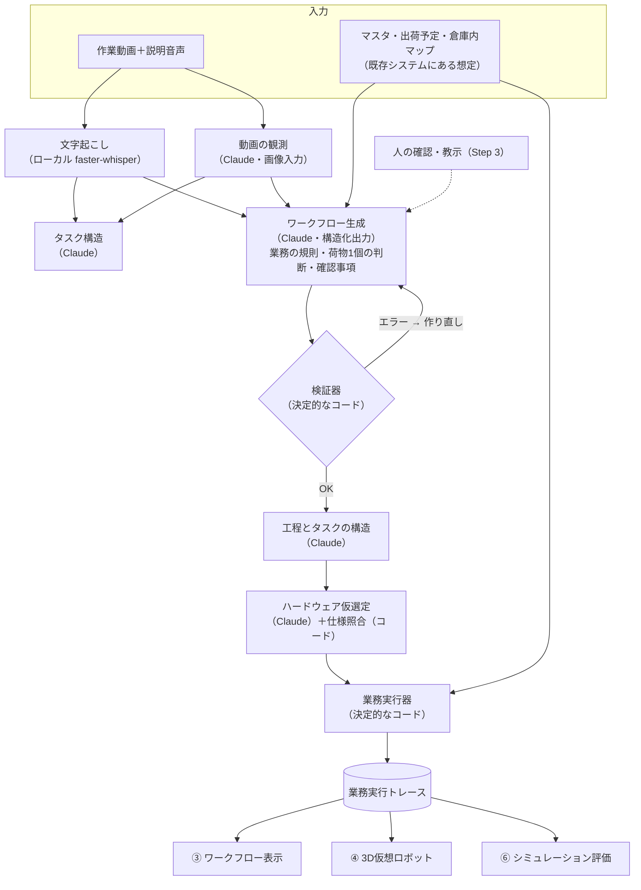

# Work2Robot

**人の作業動画と説明から業務を構造化し、必要なロボット構成を仮選定して、その構成の仮想ロボットで同じ業務を実行する。実機を入れる前に「どんな構成で、何を実証すればよいか」を示すプラットフォーム。**

> Human Work → Workflow → Robot Work → Readiness

「Built with Claude: Japan 2026」の提出作品です。提出条件・審査の観点は `docs/EVENT_RULES.md`、3分のデモ動画の構成とナレーションは `docs/DEMO.md` にあります。

---

## 1. プロダクト概要

### 解決する課題
物流現場では、作業者が荷物の重さ・形・積み具合を見ながら判断して作業しています。ロボットに置き換えようとすると、次のことが分からないまま検討が進みがちです。

- 人がどんな業務ルールで作業しているか（暗黙知）
- ロボットに必要な動作・判断の能力は何か
- どんなハードウェア構成なら対応できそうか
- 実際にロボットが作業すると、どんな動きになるか
- 実機の導入前に、何を確認・改善すべきか

### 利用者
| 立場 | 関わり方 |
|---|---|
| ロボット導入SIer・業務コンサルタント・物流拠点の管理者 | 主な利用者。実機PoCの前に業務分析・構成検討・実証条件の整理に使う |
| 作業者・現場リーダー | 情報の提供者。作業を実演し、判断の理由や例外を話す |

### 何ができるか（画面の流れ）
題材は **物流センター（食品卸）でのカゴ車への混載荷物の積付**（1台のカゴ車に15〜20個の段ボール箱・ソフトバッグ）です。

| ステップ | 画面 | やること |
|---|---|---|
| ① データ確認 | マスタ／トランザクション／その他 | 商品マスタ（荷姿・ケース入数・重量・寸法・取扱注意を含む）・カゴ車マスタ、出荷予定・出荷実績、倉庫内マップを確認し、追加・修正・削除する。WMSなど既存システムにある想定のデータで、**新しく用意するのは作業動画だけ** |
| ② シナリオ作成 | シナリオ → マスタ → トランザクション → 作業動画 → ワークフロー生成 | シナリオ（業務単位）に共通データと作業動画を紐づけ、ワークフローを生成する（文字起こし → 動画の観測 → タスク構造 → ワークフロー生成 → ハードウェア仮選定）。右に作業動画のプレビュー |
| ③ ワークフロー確認 | 業務の要約 → 工程 → タスク → 判断条件 | 業務の要約と全体の工程、工程ごとのタスクを表示する。現場への確認事項は対応したら消し込む。判断条件は**優先度順にタスクの中**に並べ、「修正」「削除」で直せる。Claudeへの自然言語の修正指示は、差分を見て承認したものだけ反映する。直すたびに新しい版として残し、戻すこともできる |
| ④ ロボット構成 | 機種・部品を選んで保存 | 業務から必要な能力（可搬重量・大きさ・リーチ・把持・計測など）を導き、Claudeが模擬カタログから構成を仮選定する。仕様の照合は決定的なコードで行い、業務要求に対して対応可能／対応不可／判断不可で示す。作業エリアの床（段差など）も要件に入る（模擬データでは段差があり、車輪移動式は対応不可、Claudeの推奨は二足歩行の HM-2） |
| ⑤ シミュレーション実行 | シナリオ × ワークフロー × 保存した構成 | 業務要件を満たす構成（対応不可なし）だけ実行できる。カゴ車1台分を仮想実行し、3Dの動作を再生して人の作業動画と比べる |
| ⑥ シミュレーション評価 | サマリ／定量評価／課題・改善余地 | シミュレーションサマリ（主要所見・効果見通し・残存課題）、タスクの達成、荷物の種類ごとの対応、推定作業時間（模擬の速度仕様による）を示す。根拠のある課題と、未検証・改善の仮説、実機PoCで確かめることを分けて示す |

### 伝えたい価値
- **可視化：** 1本の作業動画と説明から、判断を含む業務ワークフローが見える。
- **構成の検討：** 業務から必要な能力と仮のロボット構成が見え、構成を替えると仮想実行の結果が変わる。
- **PoCの準備：** どの情報・能力・安全条件を実機で確かめるべきかが明らかになる。

「自動化できる」と断言するツールではありません。**自動化に向けて、どんな構成で何を実証すればよいかが分かる**ことを価値にしています。

### 対象外・前提
- 仮想実行は**作業ロジックの検証**です。実機の把持・物理的な安定性・安全性・稼働率は実証しません。
- ロボットの機器カタログ、荷物の属性値、速度仕様は**模擬データ**です（画面にも明示しています）。実在の機種の比較・選定保証、実機の制御、VLAの学習、ROIの試算、WMSとの本番連携は扱いません。
- デモの入力動画は、プログラムで生成した**模擬作業動画**に作業者役の説明音声を付けたものです（`docs/DEMO_INPUT.md`）。

詳細な要件は `docs/PRODUCT.md` を参照してください。

---

## 2. システムの大枠

### 全体の流れ


### Claude と決定的なコードの分担
理解と提案は Claude、判定と実行はコードに分けています。Claudeの出力は必ず検証器を通し、通らなければ理由を返して作り直させます。生成したコードは実行しません（`eval` を使わない）。

| Claude が担当（理解と提案） | 決定的なコードが担当（判定と実行） |
|---|---|
| 動画のフレームから見える事実を時刻付きで観測する | ワークフローの構造・分岐・基準値の根拠の検証 |
| 説明と観測から業務の規則・判断の分岐・例外を構造化し、根拠（発話・観測の場面）と結びつける | 3値（はい／いいえ／不明）での分岐の判定 |
| 業務全体を工程とタスクに分け、判断条件をタスクに持たせる | 積む順番・置き場所・繰り返し・終了条件の実行 |
| 業務に合うロボット構成を、理由・候補外・未確認の点つきで提案する | 能力要件の計算と仕様の照合、扱えない荷物の引き継ぎ |
| 利用者の自然言語の指示から修正案を作る | 作業時間の推定、3Dの動き、評価の区分 |
| 基準が未定義の条件・不足情報・実機で確かめることを挙げる | 同じ入力なら必ず同じ結果（再現性） |

画面の動きとハイライトは、すべて同じ業務実行トレースから作っています。事前に作った映像を流しているのではありません。

### Claude API の使いどころ
モデルは Claude Opus 5.5（`claude-opus-5-5`）です。

| 呼び出し | 実装 | 内容 |
|---|---|---|
| 動画の観測 | `app/backend/ai/observation.py` | フレームを画像入力として渡し、時刻付きの観測テキストを作る |
| タスク構造 | `app/backend/ai/task_structure.py` | 動画の時間軸に沿った大タスク・小タスク・判断理由 |
| ワークフロー生成 | `app/backend/ai/extraction.py` | 業務の規則（規則の一覧から根拠付きで選ぶ）、荷物1個の判断、確認事項 |
| 工程の構造 | `app/backend/ai/process_structure.py` | 工程・タスク・判断条件・分岐（タスクと条件を分けて出させる） |
| ハードウェア仮選定 | `app/backend/ai/hardware_selection.py` | 構成・選定理由・候補外・未確認の点・改善の仮説 |
| 修正案 | `app/backend/workflow_revision.py` | Step 3 の自然言語の指示から修正案と差分を作る（承認まで保存しない） |

### ワークフローの3階層
| 階層 | 内容 | 実体 |
|---|---|---|
| Level 1：業務全体 | カゴ車1台分。積む順番・置き場所の規則・繰り返し・終了前の確認 | 業務定義（`job`）＋業務実行器 |
| Level 2：荷物1個 | 属性の確認・判断・分岐・配置／人への引き継ぎ | 分岐付きワークフロー＋実行器 |
| Level 3：基本動作 | 認識・Pick・Move・Place | 業務実行トレースの基本動作 |

業務の知識（ワークフロー）とロボットの能力（ハードウェアの能力プロファイル）は**分けて管理**し、同じ業務を別の構成で評価できるようにしています。データ形式の正本は `docs/WORKFLOW_SPEC.md`、モジュールの境界は `docs/ARCHITECTURE.md` です。

### 技術構成
- **Frontend：** React / TypeScript / Vite、React Three Fiber・Three.js（3D）、React Flow（`@xyflow/react`）と dagre（フロー図）
- **Backend：** Python / FastAPI
- **AI：** Claude API（Anthropic Python SDK）、音声の文字起こしはローカルの faster-whisper
- **Workflow：** Python の決定的な検証器・実行器

---

## 3. リポジトリ構成

```text
work2robot/
├── README.md                 このファイル
├── CLAUDE.md                 Claude Code への共通の開発指示
├── docs/                     仕様の正本（下の表）
├── app/
│   ├── backend/
│   │   ├── api/app.py        FastAPI のエンドポイント（/api/v2/...）
│   │   ├── ai/               Claude の呼び出し（観測・タスク構造・抽出・工程の構造・仮選定）と文字起こし
│   │   ├── workflow/         決定的なコード
│   │   │   ├── validator.py      ワークフローの検証器
│   │   │   ├── executor.py       荷物1個の実行器（Level 2）
│   │   │   ├── job.py, job_rules.py  業務実行器（Level 1・3、業務の規則）
│   │   │   ├── hardware.py       能力要件の計算・仕様照合
│   │   │   ├── time_estimate.py  ロボット作業時間の推定
│   │   │   ├── readiness.py      シミュレーション評価
│   │   │   └── masters.py        マスタ・出荷予定の検証と読み込み
│   │   ├── analysis_job.py   Step 2「解析開始」（各処理を順に実行）
│   │   ├── workflow_revision.py  Step 3 の直接編集・修正案・版の管理
│   │   ├── robot_configs.py  Step 4 で保存するロボット構成
│   │   └── inputs.py         今の作業動画と、その動画から作った解析結果
│   ├── frontend/
│   │   ├── src/steps/        各画面（Master・Analysis・Workflow・Hardware・Execution・Evaluation）
│   │   ├── src/components/   部品（フロー図・3D・動画・判断条件の編集など）
│   │   ├── src/lib/          表示用の変換（判定はしない）
│   │   └── scripts/          画面の自動確認（npm run screenshot）・デモ素材の撮影（npm run demo:capture）
│   ├── data/                 手書きの模擬データ（Claudeの生成物ではない）
│   │   ├── masters/          商品マスタ・カゴ車などの環境マスタ（初期値）
│   │   ├── transactions/     出荷予定・出荷実績（初期値）
│   │   ├── other/            倉庫内マップ
│   │   ├── hardware_catalog.json  模擬のロボット機器カタログ
│   │   ├── skill_catalog.json     模擬のロボットスキル一覧
│   │   └── scenario_v2/, demo_input/  テスト用の手書きワークフロー・初期シナリオの入力
│   ├── eval/                 評価用の期待結果（アプリの入力経路からは読まない）
│   ├── scripts/              解析・評価をコマンドで実行するスクリプト
│   └── tests/                バックエンドのテスト（pytest）
├── tools/demo_video/         入力用の模擬作業動画の生成と、提出動画の制作（AivisSpeech によるナレーション narration_aivis.py → 組み立て build_demo.py --narrated → 確認 qa_narrated.py）
└── .claude/                  Claude Code 用のルール（rules/）と検証手順（skills/demo-audit）
```

Git に含めないもの：`.env`（APIキー）、`local_media/`（解析結果・アップロードした動画・登録したマスタ・画面確認の画像）、`materials/`（発表用の素材）。

### 資料の役割（同じ内容を複数の場所に書かない）
| ファイル | 内容 |
|---|---|
| `docs/PRODUCT.md` | 課題・利用者・機能・提供価値・対象外 |
| `docs/ARCHITECTURE.md` | モジュールの責務・画面の構成・API |
| `docs/WORKFLOW_SPEC.md` | 入力データの区分、ワークフローの構造・判定・実行ログ・根拠、業務の規則、ハードウェア構成と能力要件 |
| `docs/DEMO.md` | 3分デモの絵コンテと日本語ナレーション |
| `docs/DEMO_INPUT.md` | 入力用の模擬作業動画の要件・シナリオ・台本 |
| `docs/ACCEPTANCE.md` | 受入基準とテストの記録 |
| `docs/EVENT_RULES.md` | ハッカソンの提出条件 |
| `CLAUDE.md`・`.claude/rules/` | Claude Code への開発指示・特定コードの技術ルール |

---

## 4. 動かし方

### 準備
```bash
python -m venv .venv
.venv\Scripts\python -m pip install -r app\requirements-dev.txt
npm install --prefix app/frontend
```
Claude API を使う処理には、リポジトリ直下の `.env` に `ANTHROPIC_API_KEY=...` を書きます（Git には入れません）。

### 起動
```bash
.venv\Scripts\python -m uvicorn --app-dir app backend.api.app:app --port 8000
npm run dev --prefix app/frontend        # http://127.0.0.1:5173
```
デモで使った入力動画（`materials/input_video_v5.mp4`）と解析結果（`local_media/`）はリポジトリに含めていません。Step 2 で作業動画（mp4、音声付き）をアップロードし「解析開始」を押すと、Claude API を使って解析します（課金あり・数分）。音声の文字起こしは初回に faster-whisper のモデルをダウンロードします。

### テスト
```bash
.venv\Scripts\python -m pytest            # バックエンド
npm run test --prefix app/frontend        # フロントエンドの単体テスト
npm run screenshot --prefix app/frontend  # 起動中の画面の自動確認（Microsoft Edge を使用）
```

コマンドで解析・評価を実行する手順（観測・抽出・仮選定と評価用データとの照合）は `CLAUDE.md` の「検証と報告」にあります。

---

## 資料・出典
- イベント参加者ガイド：https://cerebralvalley.ai/e/built-with-claude-japan2026/details
- Claude Code 公式ドキュメント：https://code.claude.com/docs/en/best-practices
